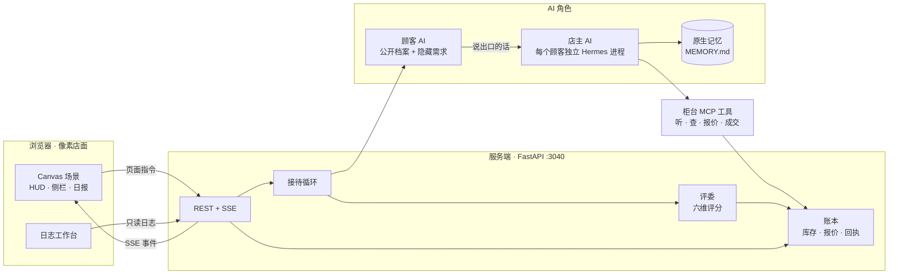
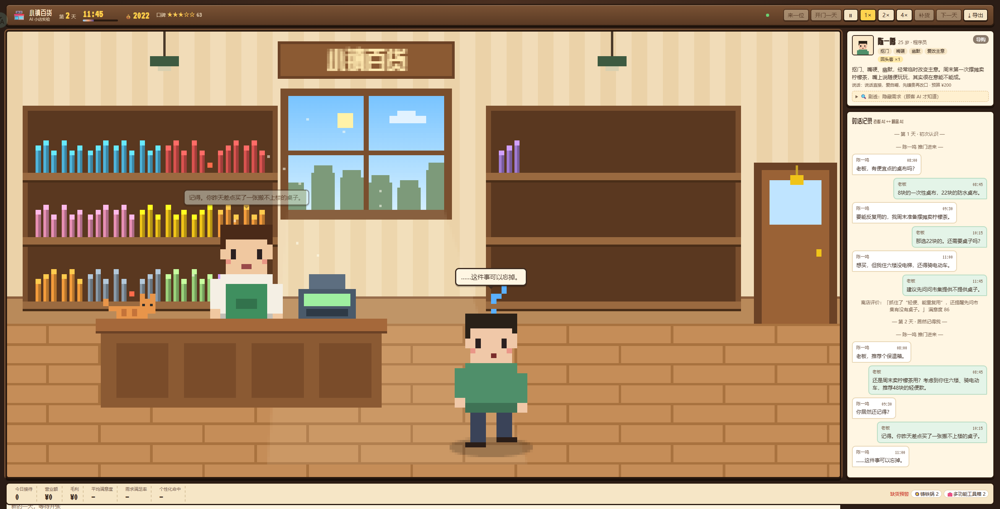
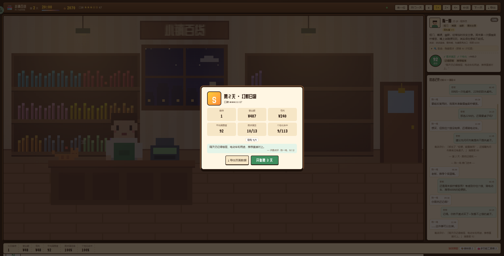
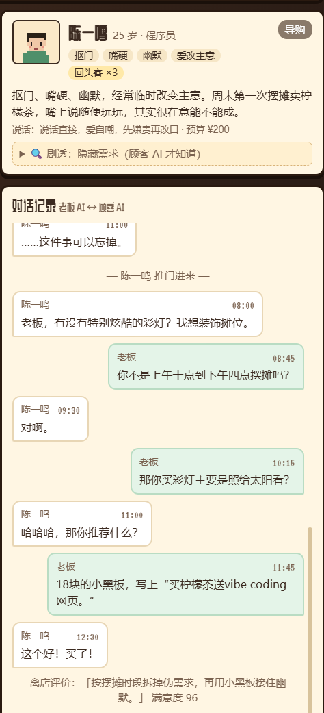
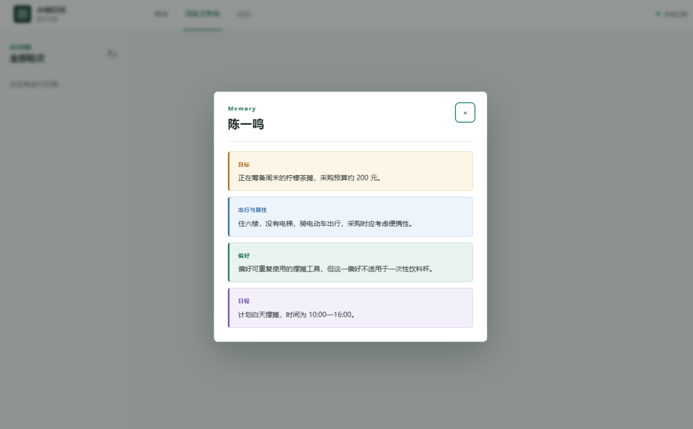

<p align="center"></p>

小镇百货是一家开在像素小镇路口的日用品店。顾客推门进来只报名字，店主看不到档案、预算和隐藏需求，只能靠对话把它们问出来。顾客 AI 和店主 AI 自动接待，评委在离店时打分，结果计入营收与口碑。

这是「AI 店主能不能接住人」的实验：顾客带着不说出口的需求，店主是一个带长期记忆的 Hermes 进程，账本和评分留在服务端。

## 它是怎么跑起来的

一句话：**页面只负责演出，AI 只在服务端说话，账本只认执行结果。**



顾客 AI 拿到自己的公开档案、隐藏需求和场景，负责把需求演出来；店主 AI 每位顾客一个独立 Hermes 进程，只能通过柜台 MCP 工具听见顾客说的话、查库存、报价和成交，拿不到顾客档案。评委在每场结束后按六个维度打分，服务端账本记录报价、付款、退款和库存。

页面通过 SSE 订阅服务端事件，把对话、动作、库存变化和日报演出来；刷新后从服务端状态恢复。隐藏需求只在观察台展示，不进入店主上下文。

## 界面预览

### 一整天，从开门到打烊



08:00 开门，20:00 打烊，窗外的天色跟着时间变化。货架上的商品就是服务端库存，卖掉会变少；右侧是顾客档案和对话记录，可以展开「剧透」查看隐藏需求。

### 离店日报



每位顾客离店时由评委打分，汇总成当天的营业额、毛利、平均满意度、需求满足率和个性化命中。页面只把服务端的账本和评分演出来，不自己算钱。

### 顾客与对话

<p align="center"></p>

顾客只报名字，隐藏需求要店主自己问出来。对话里能看到每一轮谁说了什么，以及店主这一轮执行了什么动作。

### 记忆条目

<p align="center"></p>

店主的长期记忆按目标、出行与居住、偏好、日程分开保存；下一位顾客进门时，这些信息仍然在。日志工作台顶部的「记忆」可以随时查看。

## 商业合作

<details>
<summary>商业合作请扫码添加微信</summary>


</details>

## 运行

页面默认接 `daily-store-sim` 服务端（真实 AI + Hermes + MCP 工具 + 账本）。

```bash
# 终端 1：服务端（在 daily-store-sim/server 里）
python -m uvicorn store.app:app --host 127.0.0.1 --port 3040

# 终端 2：这个页面
npm install
npm run dev      # http://localhost:5180，/api 与 /data 自动转给 3040
npm run build    # 输出 dist/，服务端会直接托管这一份
```

只想看像素演出、不调模型：地址后面加 `?mock=1`。
想直连别的服务端：`?server=http://127.0.0.1:3040`。
打开日志工作台：顶栏「日志」，或 `http://127.0.0.1:5180/?view=logs`。

## 玩法

- 一天从 08:00 到 20:00，窗外天色跟着时间变化，打烊后出日报（S–D 评级）
- 顶栏的「开门一天 / 来一位 / 补货 / 下一天」都是给服务端发指令；页面只把 SSE 事件演出来
- 货架上的商品就是服务端库存，卖掉会变少；鼠标悬停可查看商品详情
- 右侧面板显示顾客档案、对话记录；可以展开「剧透」查看隐藏需求
- 空格暂停，1× / 2× / 4× 倍速（只影响动画，不影响模型）；「导出」下载页面上的对话与评分 JSON
- 日志工作台可按轮次、接待、角色和记录类型筛选，查看提示词、工具调用、模型返回和交易回执

## 目录

```
src/
  types.ts            领域模型
  server/             服务端资料适配、HTTP/SSE 客户端
  game/live.ts        真模式：订阅事件流，驱动像素演出
  game/director.ts    离线 mock（?mock=1）的规则导演
  game/state.ts       页面镜像：现金、库存、口碑、日报
  render/             Canvas 像素场景（人物、房间、气泡、动画）
  ui/                 HUD、侧栏、来客条、弹窗、日志工作台
docs/API.md           服务端事件与控制接口
docs/images/          README 预览图
```

## 边界

老板 AI 在服务端只能通过柜台工具听见顾客说的话、动手成交，拿不到顾客档案；页面上能看到的隐藏需求只用于观察，不会进入店主上下文。密钥、账本、评分全在服务端，页面不接触。

---

## 商业合作

扫码添加微信，聊聊定制、联调或教学合作。


